# Detección de disponibilidad visual en góndolas

Proyecto de título APT orientado a detectar condiciones de baja disponibilidad visual en góndolas de supermercado mediante visión computacional.

La propuesta busca analizar imágenes de góndolas, estimar ocupación visual por nivel y alertar cuando baje del **30 %**. El MVP ya muestra un **porcentaje experimental de frente visible ocupado** cuando puede detectar niveles y ancho útil automáticamente. No representa unidades físicas; la alerta operativa sigue suspendida hasta validar ese porcentaje en imágenes etiquetadas.

> El proyecto no busca calcular inventario físico exacto ni identificar obligatoriamente cada SKU. Su propósito es entregar una señal visual, trazable y revisable para priorizar la inspección o reposición.

## Problema

La supervisión de góndolas se realiza habitualmente mediante recorridos manuales. Esto puede generar detecciones tardías de espacios con pocos productos visibles y resultados que dependen de la observación de cada persona.

Una fotografía contiene evidencia útil, pero requiere un proceso consistente para convertirla en una decisión operativa. El proyecto propone ese flujo: imagen, análisis, cálculo de disponibilidad visual, alerta y evidencia para revisión humana.

## Objetivo

Desarrollar una plataforma web que estime la disponibilidad visual de productos en góndolas a partir de imágenes, genere alertas bajo un umbral configurable y conserve evidencia de cada análisis.

## Alcance del MVP beta implementado

- Carga de JPG, PNG o WebP completos para detectar productos visibles; la cámara se retiró de la interfaz para concentrar la validación en imágenes.
- API FastAPI con límites básicos de formato, peso, resolución y región.
- Detección de productos visibles con dos checkpoints YOLO seleccionables en Análisis visual: **Detector de productos · Principal** y **Detector de productos · Comparativo (YOLO26n)**. Ambos pesos se distribuyen fuera de Git.
- Estimación automática y provisional del porcentaje de ancho frontal cubierto por productos, por nivel y como promedio de niveles medidos. Si no puede establecer los límites, informa «no evaluable». El umbral objetivo sigue siendo **30 %**; se señala un nivel candidato bajo el umbral, pero la alerta operativa continúa desactivada. Un segundo detector puede mostrar cajas de huecos candidatas sin convertirlas en verdad-terreno.
- Visualización de las detecciones y resultado en la web; API y Docker para ejecución local.

El [manual del MVP](MVP_GONDOLAS.md) contiene instalación, entrenamiento y límites. **Aún no hay historial persistente ni autenticación real**: login y CRUD funcionan solo como demostración en el navegador.

Actualización local del 21-10-2026: el modelo del compañero obtuvo mAP50 de 82,0 % en las mismas 30 imágenes de prueba donde YOLO26n obtuvo 47,7 %; por ello se selecciona por defecto para **productos**. La prueba abarca pocas escenas y no valida huecos ni stock. Se incorporó un dataset local de cajas de vacío como candidato de entrenamiento independiente; véase [auditoría y experimento de vacíos](docs/DATASET_VACIOS_V1.md). El detector previo de huecos **no se activó** por falsos positivos en las fotos del proyecto; ver [experimento de huecos](docs/EXPERIMENTO_HUECOS.md). Ejecutar `INICIAR_MVP.cmd` y abrir `http://127.0.0.1:8000/`. Los pesos y datasets locales no se incluyen automáticamente al clonar el repositorio.

### Fuera de alcance inicial

- Inventario físico exacto o integración con sistemas internos de stock.
- Reconocimiento obligatorio de SKU, marca o producto individual.
- Cámara en vivo integrada a producción.
- Reposición automática sin validación humana.
- Reentrenamiento autónomo del modelo en producción.

## Arquitectura propuesta

```mermaid
flowchart LR
    A[Imagen de góndola] --> B[API FastAPI]
    B --> C[Validación de imagen]
    C --> D[Detector YOLO]
    D --> E[Cálculo de cobertura visual]
    E --> F[Porcentaje experimental por nivel]
    F --> G[Candidato bajo 30 por ciento y evidencia]
    G --> H[Revisión humana obligatoria]
    H -. etapa pendiente .-> I[Alerta e historial persistente]
```



## Tecnologías consideradas

| Componente | Propuesta | Propósito |
|---|---|---|
| Visión computacional | YOLO, OpenCV y NumPy | Detectar productos y estimar cobertura visual. |
| Backend | Python y FastAPI | Exponer el análisis mediante una API. |
| Persistencia | Base de datos relacional | Guardar usuarios, análisis, alertas y configuración. |
| Interfaz | Aplicación web | Cargar imágenes, revisar resultados y consultar historial. |
| Despliegue | Docker | Ejecutar el sistema de forma reproducible. |

## Datos y estado actual

El dataset de trabajo recibido contenía 60 imágenes. Tras eliminar un duplicado, se estandarizaron **59 imágenes únicas**. Las anotaciones disponibles son cajas delimitadoras de detección, por lo que permiten construir una línea base de YOLO.

El proyecto está en Fase 2, con frontend y API beta. En un test local de 30 imágenes, el modelo del compañero tiene mAP50 = 0,8200 para **productos** y el anterior YOLO26n 0,4773. El indicador de ocupación necesita anotaciones de regiones y vacíos locales para validarse: la API devuelve un porcentaje **experimental cuando puede inferir niveles**, o `null` si no puede; la alerta operativa permanece siempre en `null`. No se debe interpretar este prototipo como un sistema listo para producción.

## Informe intermedio de avance — 21 de octubre de 2026

El [informe intermedio](docs/INFORME_INTERMEDIO_2026-10-21.md) registra estado de módulos, planificación actualizada, riesgos, 10 casos favorables y 10 problemáticos, junto con un plan de mejora. Las fotografías originales y salidas anotadas se mantienen **locales**, sin subirlas al repositorio público hasta aclarar permisos de publicación. El [guion de demostración](docs/GUIA_DEMO_INTERMEDIA.md) permite grabar una prueba funcional de 5–10 minutos; **no se presenta un video como realizado**.

### Estrategia técnica y razones

| Elección | Uso real | Justificación y límite |
|---|---|---|
| Ultralytics YOLO con dos checkpoints | Detectar una clase `product` en fotografías | Da cajas rápidas y comparables; detectar productos no prueba disponibilidad. El checkpoint del compañero queda por defecto por su mejor mAP50 en el test local de 30 imágenes. |
| Python, FastAPI, Pillow y NumPy | Validación de archivos, inferencia, agrupación de niveles y API | Separan la lógica visual de la interfaz y permiten pruebas automatizadas. |
| Proyección horizontal de cajas por nivel | Estimar frente visible ocupado | Evita confundir número de productos con porcentaje de stock. Depende de detectar correctamente el ancho útil y los productos; no mide profundidad ni inventario físico. |
| HTML, CSS y JavaScript sin framework | Interfaz beta de carga, visualización y usuarios de demostración | Reduce dependencias para el MVP. Login, roles y CRUD de usuarios viven en `localStorage`/`sessionStorage`: **no son seguridad ni persistencia multiusuario**. La configuración de zonas se retiró de la demo. |
| Docker Compose | Empaquetar API e interfaz | Facilita reproducir la ejecución; los checkpoints se montan por separado y no se descargan automáticamente. |

El detector de vacíos es opcional y diagnóstico: sus cajas no alimentan el porcentaje ni activan alertas. Véanse [método de ocupación](docs/ESTIMACION_OCUPACION_FRONTAL.md), [dataset de vacíos](docs/DATASET_VACIOS_V1.md) y [fallos observados](docs/REVISION_CANDIDATOS_PILOTO.md).

### Datos y preparación

| Conjunto | Procedencia y tamaño | Preparación / restricción |
|---|---|---|
| Piloto recibido | 60 fotos: 15 recortes `grocery` y 45 escenas `supermarket` | Una duplicada exacta (`004`/`035`); 59 únicas. Inventario y cola de etiquetado; **sin verdad de terreno de stock revisada**. |
| `standardized_yolo_v1` | 59 imágenes únicas, 9.651 cajas de producto | Estandarización a una clase y partición 41/9/9; línea base preliminar. |
| `shelf_products_v2` | 734 train, 29 val, 30 test | Agrupación por escena y exclusión de variantes ambiguas/repetidas para comparar detectores de productos. El test procede de pocas escenas. |
| Vacíos públicos / locales | Ver [registro de procedencia](docs/DATASET_VACIOS_V1.md) | Sólo experimentación; licencia y dominio de datos deben revisarse antes de redistribuir imágenes o pesos. |

Los datasets, fotos originales y pesos no se distribuyen por Git. No se debe sustituir su ausencia por imágenes o modelos genéricos y declarar que el piloto funciona.

### Instalación y prueba reproducible

Requisitos: Python 3.11 o Docker con Compose; acceso **autorizado** a `artifacts/models/companero-yolo.pt` (una clase `product`). El otro checkpoint es opcional.

```powershell
python -m venv .venv
.\.venv\Scripts\python.exe -m pip install -r backend/requirements.txt
.\.venv\Scripts\python.exe -m uvicorn backend.app:app --host 127.0.0.1 --port 8000
```

Abrir `http://127.0.0.1:8000/`; consultar `http://127.0.0.1:8000/api/health` para verificar `weights_loaded=true`. En la pantalla **Análisis visual**, cargar un JPG, PNG o WebP y comparar las cajas verdes con la foto. No interpretar `occupancy_percent` como inventario. Si faltan pesos, `/api/analyze` responde 503. Alternativa Docker: `docker compose up --build` con el checkpoint ya ubicado en `artifacts/models/`. Para pruebas automatizadas: `.\.venv\Scripts\python.exe -m pytest -q tests` (instalar `pytest` si no está presente).

Para repetir el barrido del informe sobre fotografías autorizadas ubicadas localmente en `data/stock_ground_truth_v1/images/`, ejecutar `.\.venv\Scripts\python.exe -m scripts.evaluar_piloto_intermedio`. Produce JSON y previsualizaciones en `artifacts/diagnostics/informe-intermedio/`; no calcula exactitud sin etiquetas humanas.

### Estructura relevante

`backend/` contiene API, inferencia, preparación y evaluación; `frontend/` la interfaz beta; `tests/` pruebas; `scripts/` automatización de evidencias; `docs/` metodología e informe; `data/` manifiestos y datos locales excluidos según `.gitignore`; `artifacts/` pesos y diagnósticos locales excluidos. El archivo `compose.yaml` define el servicio de inferencia y monta los pesos de solo lectura.

## Entregables de Fase 1

Los entregables requeridos por la asignatura se encuentran bajo la ruta exacta que será revisada automáticamente:

```text
002D/
└── Equipo XX/
    └── Fase 1/
        ├── Evidencias Individuales/
        └── Evidencias Grupales/
```

Incluye evidencias individuales, evaluación formativa, guía de definición del proyecto, planilla de evaluación y `Presentación Proyecto.pptx` con el nombre solicitado.

## Próximo hito

Mejorar la detección y evaluar el indicador de disponibilidad visual con imágenes reales y regiones de estante etiquetadas. Después incorporar persistencia y autenticación del backend.

## Principios del proyecto

- La alerta es una ayuda para la revisión humana, no una decisión autónoma de reposición.
- Cada análisis debe ser trazable a su imagen, umbral aplicado, fecha y versión del modelo.
- Las mejoras del dataset deben versionarse y validarse antes de incorporarse al entrenamiento.
- No se publican datos sensibles ni información comercial del cliente.
