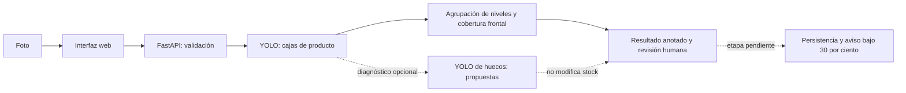

# Informe intermedio de avance del proyecto Walmart Computer Vision

**Fecha de corte:** 21 de octubre de 2026. **Etapa:** MVP beta. **Equipo:** 002D, integrantes y asignación final de responsabilidades por confirmar.

## Resumen ejecutivo

Existe un flujo funcional de fotografía a detecciones de productos y estimación experimental de ocupación frontal por nivel. En un barrido local de 44 escenas únicas de supermercado, la API respondió en las 44, calculó un porcentaje en 39 y declaró 5 como no evaluables. Ninguna recibió una alerta operativa: el umbral del 30 % aún no está validado. La tarea principal antes del piloto es conseguir etiquetas humanas de frente útil y vacío real, medir error y falsos avisos, y recién entonces decidir si se activa la alarma. El login y CRUD visibles son demostraciones del navegador, no un backend seguro.

## 1. Avance y módulos

Los porcentajes siguientes son **estimaciones de avance de ingeniería**, no métricas de rendimiento ni compromiso contractual. La base de cada estimación es funcionalidad ejecutada versus funcionalidad requerida para el MVP.

| Módulo | Estado y avance estimado | Evidencia y trabajo restante |
|---|---|---|
| Interfaz de carga y visualización | Beta, 75 % | Carga foto, elige modelo, muestra cajas y niveles en `frontend/`; faltan accesibilidad y pruebas en PC Duoc. |
| API e inferencia de productos | Beta, 80 % | `POST /api/analyze`, validación de archivos, dos modelos y 44/44 respuestas HTTP 200 en el barrido local; falta prueba de carga/hardware objetivo. |
| Detección de productos | Experimental, 70 % | mAP50 = 0,8200 del checkpoint predeterminado frente a 0,4773 del anterior en el mismo test de 30 imágenes y pocas escenas; falta generalización local y análisis de errores anotados. |
| Ocupación por nivel | Experimental, 40 % | Produce porcentaje en 39/44 escenas únicas; las otras 5 devuelven `null`. Sin verdad-terreno no hay error de porcentaje ni precisión de alarma. |
| Detector de vacíos | Candidato, 25 % | Puede dibujar propuestas; hay omisiones y falsos positivos. No modifica ocupación ni alarmas. |
| Alerta bajo 30 % | Pendiente de validación, 10 % | Umbral configurable y `low_stock_candidate` existen; `low_stock_alert=null` y `threshold_applied=false` siempre. No se envían avisos. |
| Login, roles y CRUD persistente | Demostración, 25 % | `localStorage`/`sessionStorage`; no hay autenticación del servidor ni base de datos. |
| Docker y documentación | Beta, 60 % | `Dockerfile`, `compose.yaml`, README e instrucciones; pesos fuera de Git y ejecución en PC Duoc por verificar. |

### Actividades realizadas

Se preparó el piloto de 60 fotos; se halló un duplicado exacto (`supermarket_004`/`035`). Se estandarizaron datos de producto, se entrenaron y compararon dos checkpoints, se añadió un detector independiente de huecos en modo diagnóstico y se reemplazó el conteo de productos como supuesto porcentaje por una proyección horizontal por nivel. El análisis preserva la foto original y una salida anotada local. Código, protocolo y resultados están en `backend/`, `docs/`, `data/stock_ground_truth_v1/` y `artifacts/diagnostics/informe-intermedio/`.

### Carta Gantt actualizada para la siguiente iteración

La Carta Gantt de Fase 1 está en `FINAL FASE 1/Anexos/Gestión/Plan_Gantt_y_Seguimiento_Walmart.xlsx`. Las fechas siguientes son **propuesta de actualización**, no hitos ya aprobados. No se calculan días de retraso porque no se dispone aquí de una línea base confirmada para estos hitos de Fase 2.

| Hito | Situación al 21 oct | Fecha propuesta | Responsable por asignar | Criterio de cierre |
|---|---|---|---|---|
| Flujo foto → API → cajas | Cumplido en beta | 21 oct | Desarrollo CV/API | Demo y respuesta HTTP reproducible. |
| Etiquetar 6 escenas piloto (021, 022, 036, 001, 002, 041) | Pendiente | 23 oct | Responsable de datos | ROI/niveles/huecos revisados por dos personas. |
| Evaluar error de ocupación y confusión del 30 % | Pendiente; depende del etiquetado | 26 oct | Responsable CV | MAE, falsos positivos/negativos y casos no evaluables por escena. |
| Iterar detector o geometría y congelar test | Pendiente | 28 oct | Responsable CV | Comparación antes/después sin tocar el test de ajuste. |
| Persistencia y autenticación de servidor | Pendiente | 30 oct | Responsable backend | Sesiones/roles y CRUD persistente probados. |
| Prueba Docker y latencia en PC Duoc | Pendiente | 30 oct | Responsable integración | Arranque, imagen, pesos y tiempo medido en equipo real. |
| Decisión de activar alarma operativa | Bloqueada por evaluación | Después del 30 oct | Equipo + cliente | Umbral y tolerancia de falsos avisos acordados. |

### Dificultades y riesgos

El dataset de producto no trae límites de góndola ni etiquetas de faltante; por ello no permite verificar la variable central. Fotos oblicuas, estantes cortados, reflejos y vitrinas alteran la geometría. El detector de huecos confundió un cartel con vacío en `041` y omitió espacios en `022`. Un modelo que detecta productos con buen mAP puede aun sobreestimar ocupación. El frente visible tampoco representa unidades en profundidad. La mitigación inmediata es etiquetar por nivel, separar escenas entre entrenamiento y prueba, conservar casos negativos y abstenerse de enviar alertas hasta validar el costo de errores.

## 2. Arquitectura y reproducibilidad

El README raíz contiene instalación, estructura, tecnologías, justificación y procedencia. Para reproducir el análisis hace falta un checkpoint autorizado en `artifacts/models/companero-yolo.pt`; los pesos y fotos no están en Git. Con ellos, ejecutar `python -m scripts.evaluar_piloto_intermedio` genera `resultados.json` y salidas anotadas. El historial de Git visible al corte no demuestra participación individual de todos los integrantes: se debe acordar una política de commits identificables, sin atribuir trabajo ajeno retroactivamente.

## 3. Método de resultados preliminares

Se evaluaron 44 de las 45 escenas `supermarket_*`, excluyendo `035` por ser duplicado exacto de `004`. Entradas: `data/stock_ground_truth_v1/images/`. Salidas: `artifacts/diagnostics/informe-intermedio/` (archivos del mismo nombre) y `resultados.json`. Se usó el checkpoint predeterminado, confianza 0,25 y API local. La selección de «mejores» y «peores» se hizo por inspección visual de coherencia de cajas/niveles y capacidad de reflejar huecos visibles; **no representa una clasificación por exactitud**, pues falta referencia etiquetada. El porcentaje informado es la salida del algoritmo, no un porcentaje esperado ni una tasa de acierto.

De las 44 escenas, 39 (88,6 %) recibieron un número y 5 (11,4 %) fueron no evaluables. El 88,6 % es **tasa de salida numérica**, no precisión. Ningún nivel quedó bajo 30 % y no hubo candidatos de alerta. El tiempo mediano de las solicitudes locales del barrido fue cercano a 0,32 s con modelo ya cargado; la primera tardó 4,66 s. No son mediciones p95 ni representan el PC Duoc.

### 10 casos de mejor comportamiento visual aparente

En cada caso, la entrada es `data/stock_ground_truth_v1/images/<id>.jpg` y el resultado anotado está en `artifacts/diagnostics/informe-intermedio/<id>.jpg`. **Resultado esperado preliminar** significa apreciación visual, no etiqueta revisada.

| Caso | Salida | Esperado preliminar / criterio favorable | Límite |
|---|---|---|---|
| `supermarket_003` | 85,7 %; 3 niveles | Envases alineados y varios niveles reconocibles. | La cobertura de cada nivel no está medida manualmente. |
| `supermarket_004` | 95,4 %; 2 niveles | Frente denso con cajas de producto; coherencia global. | Sólo 2 niveles propuestos; comprobar los restantes. |
| `supermarket_006` | 85,2 %; 5 niveles | Bandejas de fruta separadas en filas; visualización interpretable. | Reflejos del refrigerador. |
| `supermarket_010` | 97,3 %; 4 niveles | Bolsas densas y frentes alineados; valor alto plausible. | No prueba ausencia de huecos pequeños. |
| `supermarket_013` | 96,7 %; 4 niveles | Botellas/cartones alineados; filas coherentes. | Etiquetas de precio pueden confundir. |
| `supermarket_015` | 92,8 %; 5 niveles | Góndola de lácteos con ocupación visual alta aparente. | Vitrina y productos en segundo plano. |
| `supermarket_017` | 95,8 %; 5 niveles | Cajas frontales y varios niveles identificados. | Posible 100 % por solapamiento de cajas. |
| `supermarket_018` | 93,3 %; 3 niveles | Productos alineados en refrigerador; nivelación visible. | Reflejos y recortes laterales. |
| `supermarket_025` | 93,7 %; 8 niveles | Latas apiladas, muchos rieles con cajas dibujadas. | Ocho niveles deben confirmarse manualmente. |
| `supermarket_027` | 98,8 %; 4 niveles | Latas densas en cuatro filas aparentemente completas. | Cajas muy juntas pueden saturar la unión horizontal. |

### 10 casos problemáticos o de mayor riesgo

| Caso | Salida | Error o dificultad observable | Causa probable / mejora |
|---|---|---|---|
| `supermarket_001` | No evaluable; 0 niveles | Góndola densa pero no genera porcentaje. | Filas de productos apilados sin bases estables; detector explícito de estantes. |
| `supermarket_002` | No evaluable; 0 niveles | 916 detecciones sin frente medible. | Repetición extrema y cajas solapadas; deduplicación y geometría independiente. |
| `supermarket_011` | No evaluable; 0 niveles | Estante pequeño rodeado por pared no permite ancho útil. | Encuadre amplio; detector de ROI de góndola o protocolo de cámara. |
| `supermarket_012` | No evaluable; 0 niveles | Latas apiladas, sin filas aceptadas. | Cajas repetitivas y bases no separadas; revisar agrupamiento. |
| `supermarket_020` | 68,2 %; 3 niveles | Vitrina distante y parcialmente tapada; el número puede ser engañoso. | Reflejos/oclusiones; clasificar escena no apta antes de medir. |
| `supermarket_021` | 82,8 %; 4 niveles | Hueco evidente en cereales, pero salida global alta. | Promedio diluye un nivel vacío; evaluar contra ROI y máscara manual por nivel. |
| `supermarket_022` | 85,1 %; 4 niveles | Huecos parciales; el detector opcional de vacíos propuso 0 cajas. | Envases de distintas alturas; más positivos locales y definición de frente. |
| `supermarket_023` | No evaluable; 0 niveles | Estante de fruta muy denso sin porcentaje. | Cajas superpuestas y patrón irregular; segmentación/estructura de estante. |
| `supermarket_033` | 93,9 %; 1 nivel | Varios niveles de verduras, pero sólo uno medido. | Formas irregulares y cajas pequeñas; contar cobertura de niveles esperados. |
| `supermarket_036` | 87,0 %; 5 niveles | Nivel inferior escaso, promedio global alto; se propusieron 5 huecos opcionales. | Comparar por nivel, no sólo global; revisar propuestas y evitar falsos positivos. |

El caso `supermarket_041` queda como **regresión adicional**: el detector opcional de vacíos marcó falsamente el cartel FUJIFILM, fuera del estante. Se conserva para entrenar negativos y validar máscaras/ROI.

### Comparación y acciones prioritarias

El estimador parece más coherente en frentes rectos y densos con productos alineados. Falla o se abstiene cuando hay apilamiento repetitivo, productos irregulares, encuadre amplio o vitrinas con reflejos. Las fotos con huecos visibles (`021`, `022`, `036`) demuestran que un promedio alto no descarta faltantes locales. No existe porcentaje de acierto de stock: faltan ROI, ocupación humana por nivel y criterio acordado de alarma. Próxima evaluación: error absoluto medio de porcentaje por nivel, precisión/recall y matriz de confusión bajo 30 %, tasa de no evaluables, y latencia en el equipo objetivo. Separar por escena y no calibrar con el test final.

## 4. Conclusión y plan de mejora

Se alcanzó un prototipo reproducible para detectar productos y producir una estimación frontal revisable. No se alcanzó una alarma de bajo stock validada, ni autenticación/persistencia reales. El MVP sigue siendo viable **condicionado** a obtener imágenes representativas y etiquetas de stock, aceptar abstenciones cuando el frente no sea observable y acotar el alcance a disponibilidad visual. Si la evaluación muestra errores altos cerca del 30 %, el equipo debe mantener el sistema como apoyo a inspección humana y no habilitar avisos automáticos. Las actividades, criterios y fechas propuestas figuran en la Carta Gantt anterior; los nombres responsables y la fecha contractual deben confirmarse con el equipo y el cliente.

## 5. Demostración funcional

El guion de `docs/GUIA_DEMO_INTERMEDIA.md` cubre 5–10 minutos con arranque, salud del modelo, dos fotos contrastantes, un caso no evaluable, límites y siguiente iteración. **El video todavía requiere grabación real por el equipo**; no se sustituye con imágenes estáticas ni se afirma que ya exista.

## Fuentes de evidencia locales

- Código y contrato: `backend/app.py`, `backend/model.py`, `backend/visual_occupancy.py`, `frontend/app.js`.
- Resultados del barrido: `artifacts/diagnostics/informe-intermedio/resultados.json` y previsualizaciones del mismo directorio.
- Imágenes originales del piloto: `data/stock_ground_truth_v1/images/`, excluidas de Git por derechos y procedencia pendientes de aclarar.
- Datos y métodos: `docs/AUDITORIA_PILOTO_60.md`, `docs/ESTIMACION_OCUPACION_FRONTAL.md`, `docs/REVISION_CANDIDATOS_PILOTO.md`.
- Comparación de productos: `artifacts/models/companion_metadata.json` y `artifacts/models/metadata.json` (locales).
